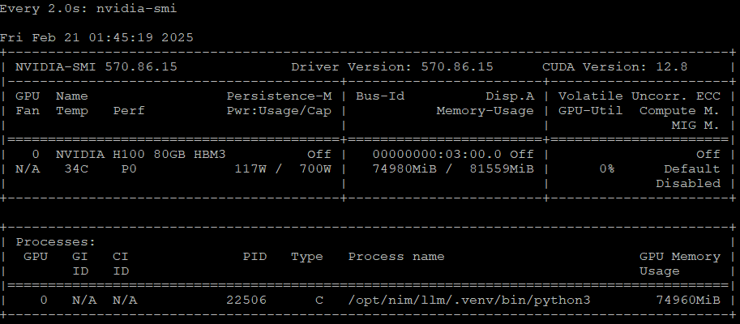

Here’s the content from the NVIDIA “Deploy a NIM on Spark” instructions formatted into a lab document-style Markdown:

***

## Lab: Deploy NVIDIA NIM on Spark DGX 🚀

### Objective

Deploy and validate an NVIDIA Inference Microservice (NIM) container hosting a large language model on a DGX Spark environment.

***

### Prerequisites

*   Access to a DGX Spark system with NVIDIA GPUs.
*   Docker, NVIDIA Container Toolkit, and GPU drivers installed.
*   NVIDIA NGC account and API key.

***

### Step 1 – Verify Environment

Ensure GPU-enabled containers are runnable:

```bash
nvidia-smi
docker --version
docker run --rm --gpus all nvcr.io/nvidia/cuda:13.0.1-devel-ubuntu24.04 nvidia-smi
```

If you hit permission errors, add your user to the Docker group:

```bash
sudo usermod -aG docker $USER
newgrp docker
```
***

### Step 2 – Configure NGC Authentication
1. Go to https://build.nvidia.com/ and login using your NVIDIA account.

2. Create an API Key
    Refer to https://docs.nvidia.com/nim/large-language-models/latest/getting-started.html#launch-nvidia-nim-for-llms

3. Use your NGC API key to authenticate with the NVIDIA container registry:

    ```bash
    export NGC_API_KEY="<YOUR_NGC_API_KEY>"
    echo "$NGC_API_KEY" | docker login nvcr.io --username '$oauthtoken' --password-stdin
    ```
***

### Step 3 – Select and Configure the NIM Container

Set environment variables for container name, image, and local caching directories:

```bash
export CONTAINER_NAME="nim-llm-demo"
export IMG_NAME="nvcr.io/nim/meta/llama-3.1-8b-instruct-dgx-spark:latest"
export LOCAL_NIM_CACHE=~/.cache/nim
export LOCAL_NIM_WORKSPACE=~/.local/share/nim/workspace
mkdir -p "$LOCAL_NIM_WORKSPACE"
chmod -R a+w "$LOCAL_NIM_WORKSPACE"
mkdir -p "$LOCAL_NIM_CACHE"
chmod -R a+w "$LOCAL_NIM_CACHE"
```
***

### Step 4 – Launch the NIM Container

Check and list all the available NIM profiles:

```bash
docker run -it --rm \
    --gpus all \
    --shm-size=16GB \
    -u $(id -u) \
    -p 8000:8000 \
    $IMG_NAME list-model-profiles
```

Run the container with GPU access, shared memory, workspace, and cache mounts:

```bash
docker run -it --rm --name=$CONTAINER_NAME \
  --gpus all \
  --shm-size=16GB \
  -e NGC_API_KEY=$NGC_API_KEY \
  -v "$LOCAL_NIM_CACHE:/opt/nim/.cache" \
  -v "$LOCAL_NIM_WORKSPACE:/opt/nim/workspace" \
  -p 8000:8000 \
  $IMG_NAME
```

*Note:* Initial run may take several minutes due to model download. Watch the logs for a “service ready” message.

***Allow approx. 30 seconds for the model to be loaded into GPU memory.***
```bash
# Monitor GPU Memory Utilization
watch nvidia-smi
```
Sample Output on a H100 system: <br>


***

### Step 5 – Validate the Inference Endpoint

In a separate terminal, test the LLM service:

```bash
curl -X 'POST' \
  'http://0.0.0.0:8000/v1/chat/completions' \
  -H 'accept: application/json' \
  -H 'Content-Type: application/json' \
  -d '{
    "model": "meta/llama-3.1-8b-instruct",
    "messages": [
      { "role": "system", "content": "detailed thinking on" },
      { "role": "user",   "content": "Can you write me a song?" }
    ],
    "top_p": 1,
    "n": 1,
    "max_tokens": 15,
    "frequency_penalty": 1.0,
    "stop": ["hello"]
  }'
```

A successful response returns JSON with a `completion` field containing generated text.

***

## ✅ Lab Complete

You’ve successfully deployed, validated, and managed an NVIDIA NIM container with GPU acceleration on DGX Spark.Would you like me to also include a **table of contents** and **estimated time per step** in the Markdown?
