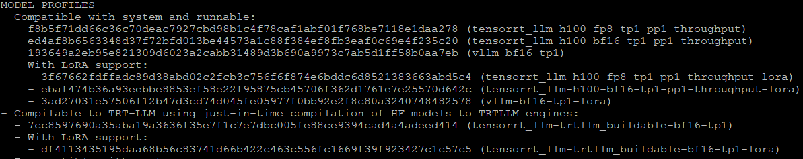
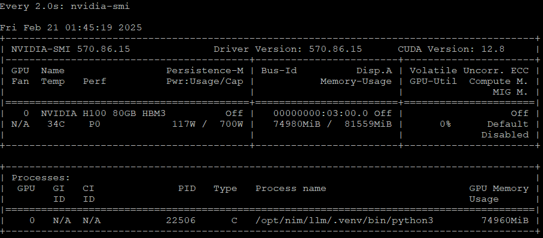
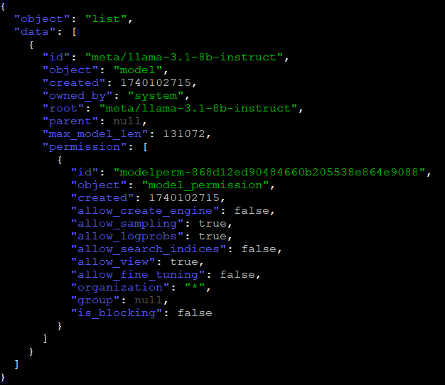
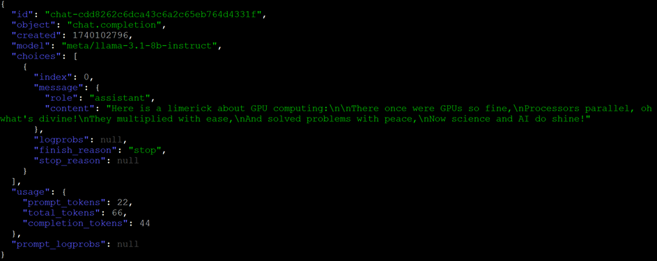
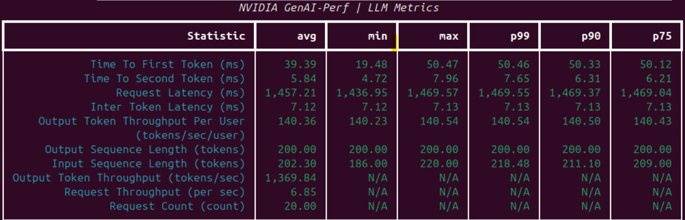

# Lab 1 - Simple NIM Deploy

## 1.1 Deploy NIM


1. Go to https://build.nvidia.com/ and login using your NVIDIA account.

<br>

2. Create an API Key

    Refer to https://docs.nvidia.com/nim/large-language-models/latest/getting-started.html#launch-nvidia-nim-for-llms

<br>

3. Using the API Key, perform docker login to nvcr.io
    ```bash
    export NGC_API_KEY="<YOUR_NGC_API_KEY>"
    echo "$NGC_API_KEY" | docker login nvcr.io --username '$oauthtoken' --password-stdin
    ```
<br>

4. List NIM profiles
    
    ```bash    
    docker run -it --rm \
        --gpus all \
        --shm-size=16GB \
        -u $(id -u) \
        -p 8000:8000 \
        nvcr.io/nim/meta/llama-3.1-8b-instruct:2.1.7 list-model-profiles
    ```
    Sample Output: <br>
    

<br>

5. Run an instance of NIM.
    
    ```bash
    export MODEL_REPO=~/workspace/models/Llama-3.1-8B-Instruct
    docker run -it --rm -d \
        --name llama-3.1-8b-instruct \
        --gpus all \
        --shm-size=16GB \
        -e NIM_MODEL_NAME=/model-repo \
        -v $MODEL_REPO:/model-repo \
        -u $(id -u) \
        -p 8000:8000 \
        nvcr.io/nim/meta/llama-3.1-8b-instruct:2.1.7
    ```

    ***Allow approx. 60 seconds for the model to be loaded into GPU memory.***
    ```bash
    # Monitor GPU Memory Utilization
    watch nvidia-smi
    ```
    Sample Output: <br>
    

<br>

6. Send test request to NIM
    
    ```bash
    curl -s -X GET 'http://0.0.0.0:8000/v1/models' | jq
    ```
    Sample Output: <br>
    

    
    ```bash
    curl -s -X 'POST' \
    'http://0.0.0.0:8000/v1/chat/completions' \
    -H 'accept: application/json' \
    -H 'Content-Type: application/json' \
    -d '{
        "model": "meta/llama-3.1-8b-instruct",
        "messages": [{"role":"user", "content":"Write a limerick about the wonders of GPU computing."}],
        "max_tokens": 64
    }' | jq
    
    ```
    Sample Output: <br>
    

<br><br><br>

## 1.2 Run GenAI-Perf Benchmark on your NIM

1. Copy the Llama 3.1 8B Instruct's tokenizer.
    
    ```bash
    export HF_TOKENIZER=~/workspace/tokenizers/Llama-3.1-8B-Tokenizer
    mkdir -p $HF_TOKENIZER

    cd ~/workspace/models/Llama-3.1-8B-Instruct/
    cp tokenizer.json tokenizer_config.json special_tokens_map.json $HF_TOKENIZER
    cd ~
    ```    
    

<br>

2. Export Variables and run Triton Server
        
    > Ensure your NIM is running
    
    
    ```bash
    export RELEASE="26.11" # recommend using latest releases in yy.mm format
    export WORKDIR=~/workspace/genai-perf
    mkdir -p "$WORKDIR"
    docker run -it --rm --net=host --gpus=all \
        -v $WORKDIR:/workdir \
        -v $HF_TOKENIZER:/root/tokenizer \
        nvcr.io/nvidia/tritonserver:${RELEASE}-py3-sdk
    ```

<br>

3. Run GenAI-Perf (on Triton Server). ***Allow for approx. 30sec for the script to finish running.***
    
    ```bash
    export INPUT_SEQUENCE_LENGTH=200
    export INPUT_SEQUENCE_STD=10
    export OUTPUT_SEQUENCE_LENGTH=200
    export CONCURRENCY=10
    export MODEL=meta/llama-3.1-8b-instruct
    
    cd /workdir
    genai-perf profile \
        -m $MODEL \
        --endpoint-type chat \
        --streaming \
        --url http://localhost:8000 \
        --synthetic-input-tokens-mean $INPUT_SEQUENCE_LENGTH \
        --synthetic-input-tokens-stddev $INPUT_SEQUENCE_STD \
        --concurrency $CONCURRENCY \
        --output-tokens-mean $OUTPUT_SEQUENCE_LENGTH \
        --extra-inputs max_tokens:$OUTPUT_SEQUENCE_LENGTH \
        --extra-inputs min_tokens:$OUTPUT_SEQUENCE_LENGTH \
        --extra-inputs ignore_eos:true \
        --tokenizer /root/tokenizer
    ```
    Sample Output: <br>
    

<br>

4. Exit out of the container.    
    
    ```bash
    exit
    ```

<br>

5. Stop running the instance of NIM with Llama-3.1-8B-Instruct  
    
    ```bash
    docker stop llama-3.1-8b-instruct
    ```

<br>

>**ADDITIONAL READING**
>
>Performing Benchmark Sweep for various use cases: 
>
>- https://docs.nvidia.com/nim/benchmarking/llm/latest/step-by-step.html#step-4-sweeping-through-a-number-of-use-cases
